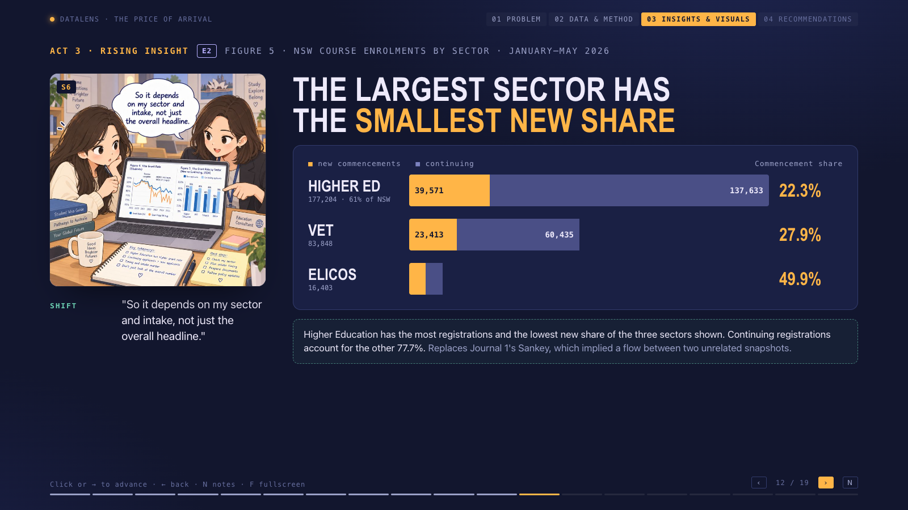

# The Price of Arrival

**A data visualisation case study by Shangcheng Lin (Katherine)**

International student enrolments, study locations, visa policy and living costs in Sydney, 2019–2026

A record-high enrolment headline tells a prospective student very little about their next intake, where their course is taught or how much flexibility they need in their budget. I worked with DataLens to turn five public datasets into an interactive story that follows Mei, a prospective Master's student, as she weighs those decisions.

[Download the interactive story](index.html) · [Watch the story film](artifacts/the-price-of-arrival-story.mp4) · [Read the English commission brief](docs/commission-brief.md)

## My role

I was a **Data Visualisation Designer focused on data-driven storytelling** in the three-person DataLens team. My work covered data preparation, audience framing, narrative design and Tableau production.

| Responsibility | What I did |
| --- | --- |
| Data sourcing and preparation | Sourced and cleaned public education and price data. I worked through inconsistent field names, date formats, reporting periods and units before the team could compare the series in Tableau. |
| Audience framing | Designed the value proposition canvas and mapped candidate charts to the decisions prospective students and advisers needed to make. I translated those needs into empathy insights, user stories and criteria viewers could demonstrate. |
| Visual analysis and Tableau | Built Figure 5 from data preparation to the Tableau dashboard export. I used stacked bars to compare sector size and the share of new commencements. The early Sankey suggested movement that the underlying snapshots could not establish. |
| Narrative design and review | Helped structure the evidence around Mei's questions, coordinated figure ownership and reviewed whether teammates' chart revisions and captions supported the claims in the story. |

DataLens produced the six-figure story, its storyboard, the interactive presentation and the film as a team. I was directly responsible for Figure 5. My teammates developed Figures 1–4 and 6. The English commission names Harbourline Education Consulting as the commissioning party.

## What the figures revealed

| Reader question | Evidence from the project snapshot | Figures |
| --- | --- | --- |
| Is the headline about my intake? | In January–May 2026, NSW course enrolments were **8.8% above** the same period in 2019. Course commencements were **17.6% below** it. The two measures describe different parts of the same system. | [Figure 1](index.html#s8) |
| Where should I look for my course? | City and Inner South accounted for **60.1%** of the known 2025 enrolments shown. The top three study regions accounted for **85.8%**. The heatmap shows that subject profiles still vary substantially across regions. | [Figure 2](index.html#s9) and [Figure 3](index.html#s10) |
| What should I check before choosing an intake? | The national visa timeline puts historical policy dates beside monthly grant rates. In the NSW sector snapshot, Higher Education had **177,204** enrolments and **22.3%** were commencements. The share for English Language Intensive Courses for Overseas Students (ELICOS) was **49.9%**. | [Figure 4](index.html#s11) and [Figure 5](index.html#s12) |
| How should I think about affordability? | By 2025, the project’s rebased annual means reached **123.00** for Sydney All Groups CPI and **114.88** for Sydney Rents CPI, alongside **116.69** for NSW enrolments. The price indices describe change in price levels. A personal budget requires separate dollar estimates. | [Figure 6](index.html#s13) |

[Figure definitions, original sources and interpretation limits](docs/methodology.md)

## How the story works

The 19-slide presentation contains ten illustrated story scenes. It introduces Mei's decision, reveals the six figures in the order she needs them, brings the evidence together and ends with four concrete planning steps. A secondary persona, Daniel, represents advisers who need captions that still make sense when a chart is shared on its own.

I used the audience's questions to decide what belonged in the story. The proposed personal budget calculator was dropped once we checked what CPI could support. The final scene asks Mei to use price trends when planning a buffer, then check current costs for her own circumstances. For the location view, the team used logarithmic colour scales to keep smaller hubs visible and retained suppressed observations as missing.

## Run locally

Download or clone the repository and open `index.html` in a desktop browser. Use **→** and **←** or the on-screen arrows to move through the slides and reveals. Press **N** for speaker notes and **F** for fullscreen. The charts and storyboard images are embedded. The page uses fallback fonts when Google Fonts is unavailable. GitHub displays the source file in the repository, so download it to run the presentation.

## Project materials

| Material | What to review |
| --- | --- |
| [English commission brief](docs/commission-brief.md) | Scope, audience, six figure specifications, deliverables and acceptance checks. |
| [Design process and contribution](docs/design-process.md) | How the four reflective journals informed the case study, plus the audience, scene and evidence mapping. |
| [Data and methodology](docs/methodology.md) | Source register, geography, dates, transformations and limits for each figure. |
| [Value proposition canvas](artifacts/value-proposition-canvas.jpg) | The original discovery artifact. Later design decisions narrowed some early concepts. |
| [Story film](artifacts/the-price-of-arrival-story.mp4) | The original linear companion. For the revised figure definitions and historical policy wording, use the current presentation and methodology. |
| [Story benchmark workbook](artifacts/story-benchmark.xlsx) | An internal rubric and proposed audience measures. The percentages in the workbook are evaluation targets. |

**Portfolio author** Shangcheng Lin (Katherine), [katherine0292](https://github.com/katherine0292)

**Original project** DataLens
