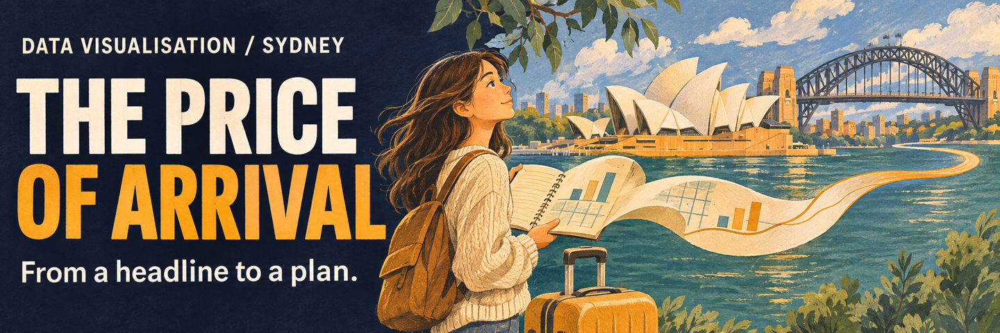

# The Price of Arrival

**An independent data visualisation project by Shangcheng Lin (Katherine)**

International student enrolments, study locations, visa policy and living costs in Sydney, 2019–2026

A record-high enrolment headline tells a prospective student very little about their next intake, where their course is taught or how much flexibility they need in their budget. I turned five public datasets into an interactive story that follows Mei, a prospective Master's student, as she weighs those decisions.

[Download the interactive story](index.html) · [Watch the story film](artifacts/the-price-of-arrival-story.mp4) · [Read the English commission brief](docs/commission-brief.md)

## My role

I completed the project independently as the **Data Visualisation Designer and Data Storyteller**, from sourcing the data to delivering the interactive presentation, companion film and evaluation workbook.

| Responsibility | What I did |
| --- | --- |
| Data sourcing and preparation | Sourced five public datasets covering enrolments, study locations, visa decisions and Sydney prices. I reconciled reporting periods and geographic boundaries, documented the baselines and retained suppressed cells as missing. |
| Audience research and framing | Created the value proposition canvas and developed two personas. I translated their decisions into user stories and defined what viewers should be able to explain after seeing each figure. |
| Visual analysis and Tableau | Designed all six figures, including the indexed trends, SA4 map, field-of-study heatmap, annotated visa timeline and sector composition chart. I chose the chart types, scales, labels and annotations to match the comparisons each figure needed to support. |
| Narrative design and production | Wrote and storyboarded Mei's ten-scene journey, built the interactive presentation with step-by-step reveals and speaker notes, and produced the companion film. |
| Documentation and evaluation | Documented the sources, calculations and limits for each figure. I built the benchmark workbook to record my self-assessment and define audience checks for a future evaluation. |

## What the figures revealed

| Reader question | Evidence from the project snapshot | Figures |
| --- | --- | --- |
| Is the headline about my intake? | In January–May 2026, NSW course enrolments were **8.8% above** the same period in 2019. Course commencements were **17.6% below** it. The two measures describe different parts of the same system. | [Figure 1](index.html#s8) |
| Where should I look for my course? | City and Inner South accounted for **60.1%** of the known 2025 enrolments shown. The top three study regions accounted for **85.8%**. The heatmap shows that subject profiles still vary substantially across regions. | [Figure 2](index.html#s9) and [Figure 3](index.html#s10) |
| What should I check before choosing an intake? | The national visa timeline puts historical policy dates beside monthly grant rates. In the NSW sector snapshot, Higher Education had **177,204** enrolments and **22.3%** were commencements. The share for English Language Intensive Courses for Overseas Students (ELICOS) was **49.9%**. | [Figure 4](index.html#s11) and [Figure 5](index.html#s12) |
| How should I think about affordability? | By 2025, the project’s rebased annual means reached **123.00** for Sydney All Groups CPI and **114.88** for Sydney Rents CPI, alongside **116.69** for NSW enrolments. The price indices describe change in price levels. A personal budget requires separate dollar estimates. | [Figure 6](index.html#s13) |

[Figure definitions, original sources and interpretation limits](docs/methodology.md)

## How the story works

The 19-slide presentation contains ten illustrated story scenes. It introduces Mei's decision, reveals the six figures in the order she needs them, brings the evidence together and ends with four concrete planning steps. A secondary persona, Daniel, represents advisers who need captions that still make sense when a chart is shared on its own.

I used the audience's questions to decide what belonged in the story. I dropped the proposed personal budget calculator after checking what CPI could support. The final scene asks Mei to use price trends when planning a buffer, then check current costs for her own circumstances. For the location view, I used logarithmic colour scales to keep smaller hubs visible and retained suppressed observations as missing.

## Run locally

Open [`portfolio/index.html`](portfolio/index.html) for the bilingual case study. Its full-width poster is exactly **1440 × 480** (3:1), with a hand-painted travel-journal style inspired by the story scenes and the presentation's midnight-blue and amber palette. The [generation prompt](assets/posters/prompt.txt) is included beside the PNG.

Download the standalone [1920 × 1200 poster](assets/posters/the-price-of-arrival-1920x1200.png), recomposed for 8:5 with the same illustrated student, Sydney harbour and data-route motif. Its [generation prompt](assets/posters/prompt-1920x1200.txt) is included alongside the PNG.

Download or clone the repository and open `index.html` in a desktop browser. Use **→** and **←** or the on-screen arrows to move through the slides and reveals. Press **N** for speaker notes and **F** for fullscreen. The charts and storyboard images are embedded. The page uses fallback fonts when Google Fonts is unavailable. GitHub displays the source file in the repository, so download it to run the presentation.

## Project materials

| Material | What to review |
| --- | --- |
| [English commission brief](docs/commission-brief.md) | Scope, audience, six figure specifications, deliverables and acceptance checks. |
| [Design process and contribution](docs/design-process.md) | How the four reflective journals informed the case study, plus the audience, scene and evidence mapping. |
| [Data and methodology](docs/methodology.md) | Source register, geography, dates, transformations and limits for each figure. |
| [Value proposition canvas](artifacts/value-proposition-canvas.jpg) | Audience needs, design responses and the figure behind each decision. |
| [Story film](artifacts/the-price-of-arrival-story.mp4) | A narrated English walkthrough of the six figures and Mei’s decision, with English captions. |
| [Story benchmark workbook](artifacts/story-benchmark.xlsx) | My self-assessment rubric and proposed audience measures. The percentages in the workbook are evaluation targets. |

**Portfolio author** Shangcheng Lin (Katherine), [katherine0292](https://github.com/katherine0292)
